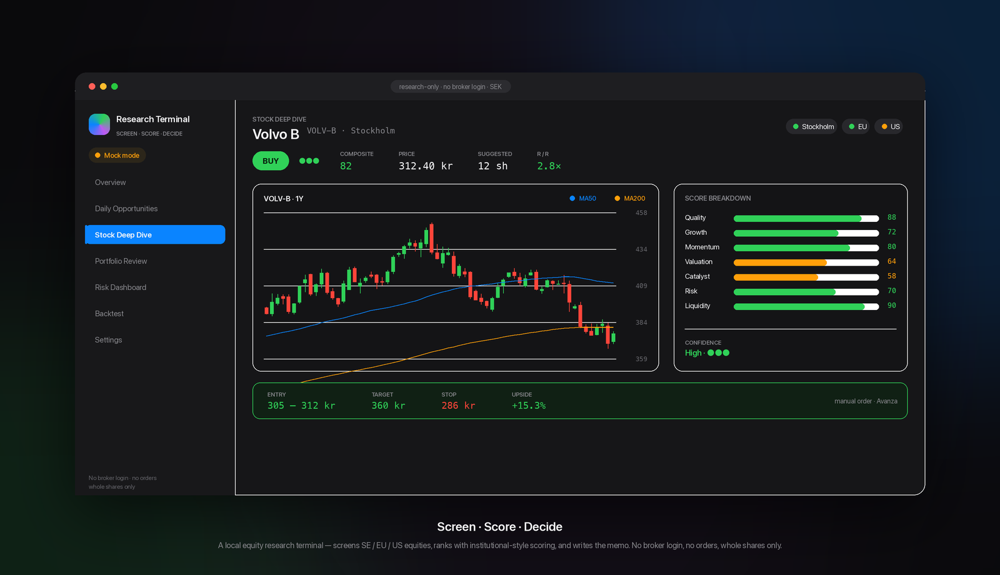

# Equity Research Terminal

[](https://github.com/Orimia/avanza-research-terminal/actions/workflows/ci.yml)
[](LICENSE)


A local research terminal that screens Swedish, EU and US equities on a transparent
multi-factor score, analyzes an existing portfolio's risk, and writes plain-language
**BUY / HOLD / TRIM / SELL / AVOID** decision memos. The investor places every order manually.

Personal project by Haonan Wang (June–July 2026), built with Claude Code as an agentic
coding partner. Scoring, sizing and risk math are deterministic, pure Python and covered
by an offline test suite.

> **Research only, by construction.** It never logs into a broker, never places orders,
> never stores broker credentials and never scrapes broker pages. A test fails the build if
> any source file contains order-execution or credential-capture identifiers.
> **This is not personal financial advice.**



_Design mockup of the Stock Deep Dive page (illustrative numbers, not a live render)._

---

## Method and limitations (read this first)

**1. Multi-factor score.** Each name gets seven 0–100 sub-scores: Quality, Growth,
Momentum, Valuation, Catalyst, Risk and Liquidity. The composite is a weighted average,
renormalised over whichever inputs are actually available (default weights in `config.yaml`:
Quality 20, Growth 20, Momentum 20, Valuation 15, Catalyst 15, Risk 10; Liquidity acts as a
gate). Missing data stays `None` and is never back-filled with mock values for a real symbol.

**2. Backtests, and what they cannot tell you.**
- Only the **momentum** rule is backtested. The history is also split into consecutive
  sub-periods and the same fixed-parameter rule is re-run on each, a **time-split robustness
  check**. Nothing is fitted in-sample, so this is a stability test, not walk-forward
  optimisation. No transaction costs; execution at the same close.
- **No fundamental backtest is implemented**, by design. Fundamental scores are single
  snapshots, not point-in-time history, so any such backtest would be look-ahead biased.
- The universe is today's list, so results carry **survivorship bias**. The UI says so next to
  every result. Treat the output as a sanity check on the signal, not a track record.

**3. Portfolio risk analytics** (`src/portfolio/intelligence.py`). Each asset needs at least
120 days of price history; correlations, beta and the Monte Carlo use the trailing (up to 252)
overlapping trading days, with a minimum of 60.
- **Correlation clusters.** Holdings with pairwise correlation ≥ 0.70 (signed) are grouped as
  connected components, single-linkage: A~B and B~C put A, B and C in one cluster.
- **Effective number of bets** = 1 / (wᵀρw) with weights normalised to sum to 1. *Limitations:*
  it uses correlation, not covariance, so it ignores volatility differences; and it is not
  clipped, so negative correlations can push it above the number of holdings. A covariance- or
  PCA-based measure would be stricter.
- **Portfolio beta** against the S&P 500 (`^GSPC`). Same-day closes understate beta for
  Swedish holdings, because the two markets close at different times.
- **Bootstrap Monte Carlo**: 2,000 one-year paths resampled from the portfolio's joint daily
  returns, seeded for reproducibility. *Limitation:* it inherits the sample period's regime,
  so a strong year inflates the median, and the UI shows that caveat.

**4. Market regime.** Index trend, momentum and a volatility ratio classify the tape as
risk-on, neutral or risk-off. The BUY threshold is adjusted on a *copy* of the config, and the
adjustment is always shown, never silent. It applies to Daily Opportunities and the engine;
the single-stock Deep Dive uses the base thresholds.

**5. Discipline checks.** Proposed actions are compared with the investor's own rules
(averaging down on a loser, more proposed changes than the monthly trade budget, chasing overbought entries,
selling high-quality names at the lows). The terminal warns and never blocks.

**6. Accountability.** Engine BUY signals open virtual positions in a **paper ledger**, filled
cost-free at the last quote. Positions close through stops or sell signals, which fire only for
names the investor also holds, so closed-trade statistics cover that subset. An efficacy module
scores past alerts by type once at least 3 can be scored, using the raw (not benchmark-relative)
return from the signal date to the latest close, and reports "collecting history" until then.

---

## What it does

- **Screens** Swedish, EU and US universes with liquidity, market-cap and penny-stock filters.
- **Sizes** positions in SEK with whole-share counts under configurable risk limits (max
  position %, high-risk cap, daily buy budget), flagging liquidity and FX risk.
- **Reviews a portfolio**: per-holding decision, weakest holding, best replacement,
  sector/country/currency exposure, concentration (HHI) and stress tests.
- **Writes decision memos** deterministically (no LLM required): thesis, bull and bear cases,
  an opportunity-cost comparison and a pre-mortem, alongside a plain-language summary that
  only rephrases numbers the engine computed.
- **Cites sources**: every news item carries source, timestamp and URL. Missing data is shown as
  `—missing—`.
- **Runs an always-on engine** that scans during market hours, de-duplicates signals against
  stored state (only *new* transitions alert), and sends Telegram/email digests.
- **Keeps crypto separate**: coins have no fundamentals, so they use their own trend, momentum
  and risk model and never touch the equity composite.

---

## Engineering notes

- **Provider chain** per region (`config.yaml → data.providers`): keyed sources (Börsdata,
  EODHD, Finnhub), then keyless Yahoo Finance, then OpenBB Platform (optional dependency), then
  a deterministic mock. Within a record, missing fields stay `None` rather than borrowing mock
  values; a symbol with no live data at all falls back to a fully synthetic record flagged as mock.
- **Field mappings verified against live APIs.** Example: Yahoo's `dividendYield` is a
  *percentage* while `trailingAnnualDividendYield` is a fraction. Mixing them once produced a
  100x yield error, now covered by tests.
- **Offline, deterministic test suite** (101 tests): network is gated off via `ALLOW_NETWORK`
  in `conftest.py`, and random seeds are fixed.
- **Every data-provider network call is logged** to `logs/network.jsonl` and shown in Settings.
  The optional LLM step is off by default and is gated separately (`reports.use_llm`).

---

## Quickstart (no API keys needed)

```bash
python3 -m venv .venv && source .venv/bin/activate   # Python 3.11+
pip install -r requirements.txt
cp .env.example .env            # optional; without keys it uses keyless Yahoo data
streamlit run src/dashboard/app.py
```

The dashboard opens at <http://localhost:8501>. On **Portfolio Review**, click **Load sample
portfolio** to see the full flow with `examples/sample_portfolio.csv`.

Useful targets: `make test`, `make lint`, `make engine` (dry run of the always-on engine),
`make letter` (preview the weekly plain-language letter). Set `ALLOW_NETWORK=false` for pure mock data.

---

## Always-on engine

```bash
python -m src.engine.scheduler            # run continuously (daemon)
python -m src.engine.scheduler once       # one full scan + send
python -m src.engine.scheduler dry-run    # full scan, print the message, send nothing
                                          # (it still updates de-dup state and paper fills)
```

Signal types: new BUY, holding TRIM/SELL changes, trailing stop and take-profit hits, big
moves, breakouts, 200-day moving-average crosses, RSI extremes and imminent earnings. Schedule (in `config.yaml → engine`):
intraday scans during Stockholm/EU/US hours plus morning and post-close digests
(Europe/Stockholm).

**Notifications:** create a Telegram bot via @BotFather and set `TELEGRAM_BOT_TOKEN` and
`TELEGRAM_CHAT_ID` in `.env` (`python -m src.alerts.telegram` lists chat ids), or set the
`ALERT_EMAIL_*` variables. No broker credentials are ever requested.

**Deploy:** `docker compose up -d --build` runs the engine and dashboard on one shared DB.
`fly.toml` is included for an always-on Fly.io worker.

---

## Live data (optional)

| Variable | Purpose |
|---|---|
| `BORSDATA_API_KEY` | Nordic fundamentals and prices |
| `EODHD_API_KEY`, `FINNHUB_API_KEY` | Global fundamentals, prices, news, earnings dates |
| `FX_API_KEY` | Live FX; static rates are used whenever the live call fails |
| `ANTHROPIC_API_KEY` | Optional LLM synthesis on top of the deterministic memo |
| `TELEGRAM_*`, `ALERT_EMAIL_*` | Optional alerts |
| `ALLOW_NETWORK` | `false` forces offline/mock data even with keys |

Without keys, Yahoo Finance provides real prices and fundamentals keylessly. The optional LLM
step is instructed to use only the deterministic memo, and any failure falls back to it.

---

## Portfolio CSV

```csv
ticker,exchange,shares,average_cost,currency,current_price_optional,sector,notes
VOLV-B,ST,40,245.0,SEK,,Industrials,Core Nordic industrial
NVDA,US,8,95.0,USD,,Technology,AI infrastructure
```

Holdings are entered manually (CSV import, paste, or the in-app editor). The app never
connects to a broker.

---

## Dashboard pages

Overview · Alerts & Engine · Daily Opportunities · Crypto Signals · Portfolio Review ·
Intelligence (risk analytics, regime, discipline, paper ledger) · Stock Deep Dive ·
Risk Dashboard · Backtest · Settings

---

## Project structure

```
src/
  config.py            # config.yaml + .env loader
  data/                # provider chain: keyed clients, Yahoo, OpenBB, mock, FX, news
  universe/            # Sweden / EU / US / crypto lists + liquidity filters
  models/schemas.py    # Pydantic schemas (missing = None, never invented)
  scoring/             # fundamentals, technicals, catalysts, risk, composite, regime
  portfolio/           # sizing, opportunity cost, risk intelligence, discipline, paper ledger
  reports/             # memo generator, citations, plain-language layer (+ optional LLM)
  backtest/            # momentum backtest, time-split robustness check, alert efficacy
  engine/              # scheduler, scanner, signal de-dup, notifications
  alerts/              # Telegram and email senders
  dashboard/           # Streamlit app and pages
  storage/             # SQLite cache, migrations, backups
  utils/               # currency, dates, network-call logging
tests/                 # offline pytest suite
```

---

## Roadmap

- Point-in-time fundamentals, so fundamental factors can be backtested without look-ahead bias.
- Survivorship-free universe snapshots.
- Covariance/PCA-based effective number of bets alongside the correlation version.
- Paper-only exits and benchmark-relative efficacy scoring.
- Market-holiday calendar and per-signal configuration in the UI.

**This is not personal financial advice.** Data may be delayed; always verify before acting.
